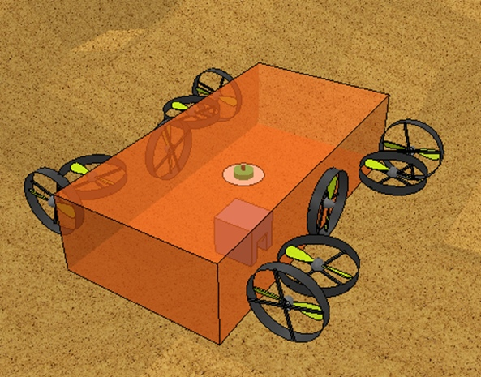

# Underwater Robot Mapping

**From a survey area to a 3D point cloud.** A Python robotics coursework project that controls a simulated underwater vehicle, plans its route and maps the seabed using a 2D LiDAR.



**Stack:** Python · PyQt5 · NumPy · Matplotlib · V-REP / CoppeliaSim legacy Remote API

**My role:** Danil Volodin — developed the robotics coursework prototype, including its interface, navigation and mapping modules.

## Run the original prototype

This is a historical Windows-oriented project, not a packaged application. The launcher uses `os.startfile`, and the repository includes `remoteApi.dll`.

1. Use a Python 3 environment and install the imported third-party packages:
   ```sh
   python -m pip install numpy matplotlib PyQt5
   ```
2. Open a supplied robot scene in a compatible V-REP/CoppeliaSim installation with the legacy Remote API available. The code expects the scene object `robot` and the original scene signals; an arbitrary scene will not work.
3. Run from the repository root so the relative UI and data paths resolve:
   ```sh
   python Interface.py
   ```
4. Start the interface server, then the mapping and navigation modules using their UI controls. On Windows, `.py` files must be associated with the intended Python environment; the modules can also be started separately with that interpreter.
5. Set the survey area and movement parameters, preview the route, then start the mission. Inspect the generated `points.csv` after scanning.

**Data note:** the mapper opens `points.csv` in append mode. Keep separate copies for separate survey runs if you do not want their points combined.

## What it does

- Builds a survey route from opposite corners of a rectangular area.
- Supports straight-line and spline-based movement.
- Exposes speed, height above the seabed and scan-frequency controls.
- Shows the planned route and the robot's reported position in a desktop interface.
- Converts sensor observations into a point cloud and appends it to `points.csv` for inspection in tools such as CloudCompare.

## Architecture

Three Python processes coordinate over local UDP sockets:

| Component | Responsibility | Local port |
| --- | --- | --- |
| `Interface.py` | PyQt interface, mission parameters, route preview and controls | 3002 |
| `Navigation.py` | Simulator connection, vehicle motion and telemetry | 3003 |
| `Mapping.py` | Scan processing and CSV output | 3001 |

`Navigation.py` connects to the simulator's legacy Remote API at `127.0.0.1:19997`. `path.py`, `Spline.py` and `PID.py` contain supporting route and control code. The `copelia/` folder includes `Bobot.ttt` and `Bobot2.ttt` scene files.

## Status and compatibility

Preserved as a robotics coursework prototype. Dependencies are not version-pinned, and compatibility with current simulator releases has not been verified. The repository contains historical generated files alongside the source. This documentation refresh does not change the controller or claim a new simulator validation.

The surviving original vehicle screenshot is stored locally in `docs/screenshots/`.


## Repository

Repository name: [underwater-robot-mapping](https://github.com/Triton556/underwater-robot-mapping).

## License

Original project code is available under the [MIT License](LICENSE). Bundled simulator API files retain their own licensing terms.
